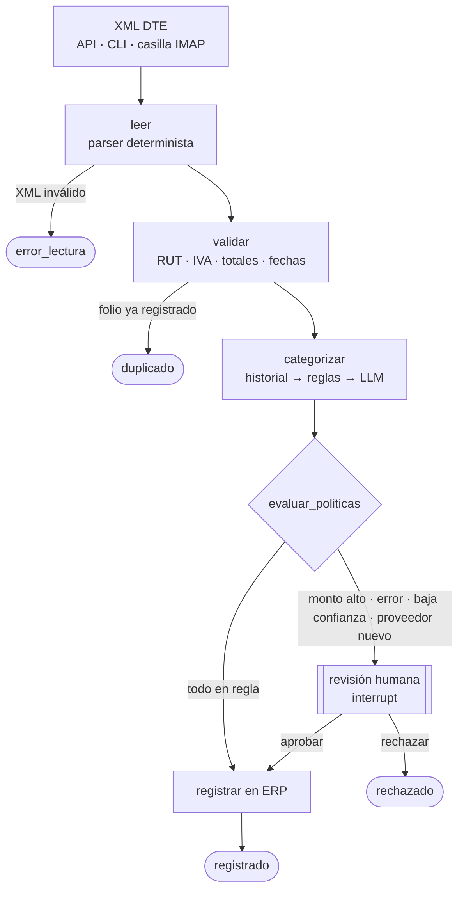

# DTE Backoffice Agent

[](https://github.com/script32/dte-backoffice-agent/actions/workflows/ci.yml)


Agente construido con **LangGraph** que automatiza la recepción de facturas de compra en empresas
chilenas: lee los XML de documentos tributarios electrónicos (DTE) del SII, valida montos y RUT,
propone la cuenta contable, pide aprobación humana cuando corresponde y registra en el sistema
contable.

Una empresa lo pone en marcha con tres cosas propias: su `config.yaml` (RUT y políticas de
aprobación), su plan de cuentas en CSV y, opcionalmente, un adaptador a su ERP.

## El problema

Una PYME recibe decenas o cientos de facturas de proveedores al mes, por correo, en XML. Alguien
tiene que revisar que estén bien emitidas, que no estén duplicadas, decidir a qué cuenta van y
digitarlas en el sistema contable. Es trabajo repetitivo, propenso a errores y donde un IVA mal
calculado o una factura duplicada cuestan dinero.

## Qué hace



1. **Lee** DTE sueltos o `EnvioDTE` con varios documentos (facturas 33 y 34, notas de crédito 61 y de débito 56).
2. **Valida** con reglas deterministas: dígito verificador de RUT, que el receptor sea la empresa, IVA contra la tasa, cuadratura del total según la fórmula oficial del SII (impuestos adicionales, garantía por envases, crédito a constructoras) y del detalle con descuentos y recargos globales, fechas futuras o antiguas, duplicados por emisor + tipo + folio.
3. **Categoriza** en el plan de cuentas de la empresa, en cascada: primero repite la cuenta usada antes con ese proveedor, luego aplica reglas configuradas y solo si nada de eso resuelve, consulta a un LLM.
4. **Decide** con políticas configurables si puede registrar solo o necesita a una persona.
5. **Pausa** con `interrupt()` de LangGraph cuando hace falta aprobación; el estado queda persistido y el flujo se reanuda días después si es necesario, desde la API o la CLI.
6. **Registra** a través de un puerto intercambiable (`LedgerPort`): incluye un libro de compras SQLite y se conecta a cualquier ERP implementando cuatro métodos.

## Decisiones de diseño

**El LLM solo donde aporta.** Un XML del SII tiene estructura fija: leerlo con un LLM sería más lento, más caro y menos confiable que un parser. Las validaciones tributarias son aritmética y también son deterministas. El modelo se usa en una sola tarea donde sí suma: elegir la cuenta contable a partir de descripciones libres, y solo cuando el historial y las reglas no alcanzan. Con el tiempo, a medida que se acumula historial, el sistema llama cada vez menos al LLM.

**El LLM propone, no decide.** Su salida es estructurada (Pydantic), se valida contra el plan de cuentas real y pasa por las mismas políticas que cualquier otra sugerencia. Si inventa una cuenta, si su confianza es baja o si la API falla, el documento va a revisión humana; el flujo nunca se cae por el modelo. Esto también acota el riesgo de *prompt injection*: el texto de una factura viene de un tercero, se entrega delimitado como datos y lo peor que puede lograr es que una persona revise el documento.

**Human-in-the-loop real, no simulado.** La revisión usa `interrupt()` y `Command(resume=...)` con un checkpointer persistente (SQLite). Un documento puede quedar pendiente mientras el contador está de vacaciones y reanudarse después sin perder estado.

**Idempotencia.** Cada documento se procesa en un hilo cuyo ID es el hash de su contenido. Reprocesar el mismo XML (un correo reenviado, un reintento de n8n) devuelve el resultado existente sin volver a llamar al LLM ni duplicar el registro. Los nodos previos a la revisión no tienen efectos secundarios, porque LangGraph re-ejecuta el nodo interrumpido al reanudar; la única escritura ocurre en `registrar`, protegida además con una restricción única.

**Arquitectura de puertos y adaptadores.** El grafo no conoce el ERP, el origen de los archivos ni el proveedor del LLM. Cambiar SQLite por Bsale, o Claude por otro modelo, no toca el grafo. Ver [docs/conectar-erp.md](docs/conectar-erp.md).

**Seguridad.** Los XML se parsean con `defusedxml` (protección contra XXE y bombas de entidades), la API admite API key y límite de tamaño, y los datos propios de la empresa (`config.yaml`, plan de cuentas real, bases de datos) están excluidos del repositorio.

## Inicio rápido

```bash
git clone https://github.com/script32/dte-backoffice-agent.git
cd dte-backoffice-agent
uv sync
cp config.example.yaml config.yaml
cp .env.example .env   # agrega ANTHROPIC_API_KEY si usarás el LLM

uv run dte-agent procesar data/samples
```

Salida abreviada con los ejemplos incluidos (datos ficticios):

```
⏸️  PENDIENTE_REVISION   Imprenta Reloncaví SpA folio 4410 $142.000
     - [ERROR] IVA declarado $22.000 no corresponde al 19% de $120.000 (esperado $22.800)
     - Proveedor nuevo: Imprenta Reloncaví SpA (78222333-K)
⏸️  PENDIENTE_REVISION   Nube Austral SpA folio 1520 $101.150
     - Proveedor nuevo: Nube Austral SpA (77111222-6)
⏸️  PENDIENTE_REVISION   TecnoSur Limitada folio 88341 $1.725.500
     - Monto $1.725.500 supera el umbral de aprobación automática ($1.000.000)
     - Proveedor nuevo: TecnoSur Limitada (76888999-6)
```

Revisar y resolver:

```bash
uv run dte-agent pendientes
uv run dte-agent revisar <thread_id> --aprobar --cuenta 1301 --revisor contador
uv run dte-agent revisar <thread_id> --rechazar --comentario "Solicitar refacturación"
```

Una vez aprobado un proveedor, sus próximas facturas se registran solas si cumplen las políticas.

## Poner en marcha en tu empresa

1. **`config.yaml`**: RUT y razón social, umbral de aprobación, confianza mínima y reglas de categorización.
2. **Plan de cuentas**: exporta el tuyo a CSV con columnas `codigo,nombre,descripcion` y apunta `categorizacion.plan_de_cuentas` a ese archivo. Una buena descripción de cada cuenta mejora mucho la categorización.
3. **Entrada de documentos**, según prefieras:
   - Casilla de intercambio DTE por IMAP: define `IMAP_*` en `.env` y programa `dte-agent correo` (cron, systemd timer o n8n).
   - API HTTP: `POST /documentos` desde n8n, tu ERP o un portal.
   - Carpeta: `dte-agent procesar /ruta/a/xml`.
4. **Sistema contable**: usa el libro SQLite incluido o implementa `LedgerPort` para tu ERP ([guía](docs/conectar-erp.md)).

### API

```bash
uv run dte-agent api            # o: docker compose up -d
```

| Método | Ruta | Descripción |
|---|---|---|
| `GET` | `/salud` | Estado del servicio |
| `POST` | `/documentos` | Sube un XML (multipart, campo `archivo`) |
| `GET` | `/revisiones` | Documentos pendientes con motivos y cuenta sugerida |
| `POST` | `/revisiones/{thread_id}` | `{"accion": "aprobar", "cuenta": "1301"}` o `{"accion": "rechazar", "comentario": "..."}` |

Si `DTE_AGENT_API_KEY` está definida, todas las rutas salvo `/salud` exigen el header `X-API-Key`.
Documentación interactiva en `http://localhost:8000/docs`.

### LangGraph Studio

```bash
uv run langgraph dev
```

Permite ver el grafo, ejecutar documentos paso a paso e inspeccionar el estado en cada nodo.

## Tests

```bash
uv run pytest
```

Cubren el parser (incluye XML malicioso), cada regla de validación y el flujo completo del grafo:
aprobación automática, pausa y reanudación, rechazo, idempotencia y la API. Los tests reemplazan
el LLM por un categorizador determinista, así que corren sin red ni API key.

## Estructura

```
src/dte_agent/
├── domain/          # Parser DTE, validaciones, RUT, modelos (sin dependencias de LangGraph)
├── graph/           # Estado y construcción del grafo
├── adapters/        # Puerto contable + libro SQLite, plan de cuentas, cola de revisiones
├── ingesta/         # Casilla de intercambio IMAP
├── categorization.py
├── service.py       # Fachada usada por API, CLI e ingesta
├── api.py
└── cli.py
```

## Hoja de ruta

- Adaptadores para ERPs chilenos con API pública.
- Checkpointer PostgreSQL para despliegues con varias réplicas.
- Documentos sin XML (PDF o foto) con extracción mediante modelo de visión, pasando por las mismas validaciones.
- Respuesta automática de aceptación o reclamo al proveedor dentro del plazo legal.
- Evaluación de la categorización contra un conjunto etiquetado.

## Licencia

MIT. Los XML de `data/samples` contienen datos ficticios generados para pruebas.
